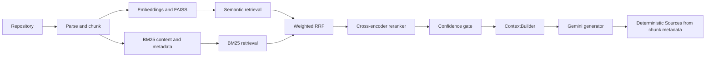

# AI Code Investigator

A repository question-answering RAG tool. It indexes source and documentation chunks, retrieves evidence using semantic and lexical search, reranks candidates, and answers questions with citations generated only from retrieved chunk metadata.

## Architecture



## Setup

Use Python 3.10 or newer. On Windows PowerShell:

```powershell
py -m venv .venv
.\.venv\Scripts\Activate.ps1
python -m pip install -r requirements.txt
```

The sentence-transformer and cross-encoder models must be available in the local Hugging Face cache on first use. To require offline model loading:

```powershell
$env:HF_HUB_OFFLINE = "1"
```

Set the Gemini API key in `rag/.env` (or the process environment); do not commit the file:

```dotenv
GOOGLE_API_KEY=your_key_here
```

Generation requires a valid key and network access. Transient Gemini 429/5xx errors are retried; if the service remains unavailable, generation returns a user-safe error and does not emit citations for an answer that was never produced.

## Indexing

The indexer is exposed as a Python API. From the repository root:

```python
from pathlib import Path
from embeddings.indexer import index_repository

store, _ = index_repository("<repository-url>", Path("data/repos/<name>"))
store.save("data/vectorstore")
```

The persisted vector store requires both `data/vectorstore/index.faiss` and `data/vectorstore/metadata.pkl`. Rebuild the index after changing the indexed repository or embedding model.

## Use

Launch the Streamlit chat interface:

```powershell
.\.venv\Scripts\python.exe -m streamlit run streamlit_app.py
```

The sidebar shows vector-index availability and active model/retrieval settings. Chat history persists for the session; use **Clear conversation** to reset it. Retrieved context and file contents appear only in expandable sections, with dotenv files omitted and common credential patterns redacted from displayed content. The runtime is cached for the Streamlit session so embedding and reranker models are not reloaded for each question.

If Streamlit is not installed, install the project dependencies with `python -m pip install -r requirements.txt`. Running `python streamlit_app.py` without Streamlit prints an installation hint instead of failing on import.

Start the interactive question loop:

```powershell
python -m rag.cli
```

Enter a question; type `exit` or `quit` to stop. The one-shot runtime smoke test performs retrieval, builds the actual prompt context, calls Gemini, and verifies that every displayed source is derived from the retrieved chunks:

```powershell
python -m rag.test
```

## Configuration

All settings are optional and have safe defaults. Environment variables override defaults:

| Variable | Default | Purpose |
| --- | --- | --- |
| `RAG_EMBEDDING_MODEL` | `BAAI/bge-small-en-v1.5` | Sentence-transformer used for query and chunk vectors. Changing it requires rebuilding the vector index. |
| `RAG_RERANKER_MODEL` | `cross-encoder/ms-marco-MiniLM-L-6-v2` | Cross-encoder used to rerank fused candidates. |
| `RAG_RETRIEVAL_CANDIDATES` | `20` | Maximum candidates fetched from each retriever and fused. |
| `RAG_SEMANTIC_MIN_SCORE` | `0.57` | Minimum cosine-like semantic score retained by semantic retrieval. |
| `RAG_SEMANTIC_WEIGHT` | `1.0` | Weighted-RRF contribution for semantic rank. |
| `RAG_KEYWORD_WEIGHT` | `2.0` | Weighted-RRF contribution for BM25 rank. |
| `RAG_RRF_K` | `60` | Reciprocal-rank smoothing constant. |
| `RAG_CONFIDENCE_THRESHOLD` | `0.40` | Minimum combined reranker, semantic, BM25, and RRF confidence of the top reranked result required to return the query's reranked context. Range: 0 to 1. |
| `RAG_GEMINI_MODEL` | `gemini-3.6-flash` | Gemini model used to generate answers. |
| `RAG_GENERATION_RETRIES` | `3` | Number of retries after the initial request, for HTTP 429/500/502/503/504 only. |
| `RAG_GENERATION_BACKOFF_SECONDS` | `0.5` | Initial retry delay; each retry doubles it. |
| `RAG_LOG_LEVEL` | `INFO` | Python log level, e.g. `DEBUG`, `INFO`, `WARNING`, or `ERROR`. Logs exclude prompts, chunk contents, and credentials. |
| `GOOGLE_API_KEY` | unset | Gemini credential; load from `rag/.env` or the process environment. |

The Streamlit frontend does not define a second set of backend configuration values; it reads the same `Settings` object used by the runtime.

## Tests and Evaluation

Run tests without Gemini calls:

```powershell
python -m unittest discover -s tests -v
```

Compile all project Python sources:

```powershell
python -m compileall -q app embeddings rag tests
```

Evaluate the 19 deterministic cases (17 answerable, 2 unanswerable); evaluation does not invoke Gemini:

```powershell
python -m embeddings.evaluation
```

If model downloads are unavailable, require locally cached models:

```powershell
$env:HF_HUB_OFFLINE = "1"
python -m embeddings.evaluation
```

Evaluation reports answerable file-level Recall@5, no-answer accuracy, and an overall score. The small sample index is useful as a smoke benchmark, not a statistically representative quality estimate.

## Limitations

- Confidence is a calibrated heuristic over model-dependent scores, not a probability. It abstains at the query level based on the top result; it does not discard lower-ranked chunks once the query passes the gate. Tune `RAG_CONFIDENCE_THRESHOLD` against a larger labeled set for other repositories.
- The current sample index covers only `README.md`, `main.py`, and `tools.py`; its Recall@5 can saturate easily.
- Generic irrelevant questions can still share semantic or lexical signals with the indexed corpus. No-answer accuracy must be monitored as indexes and domains change.
- Gemini may return transient 503 errors during capacity spikes. Retries are bounded; the application reports a safe error when they are exhausted and does not fabricate a Sources section.
- Hugging Face models require a local cache or network access on first use. Offline tests use fakes and do not load either model.
